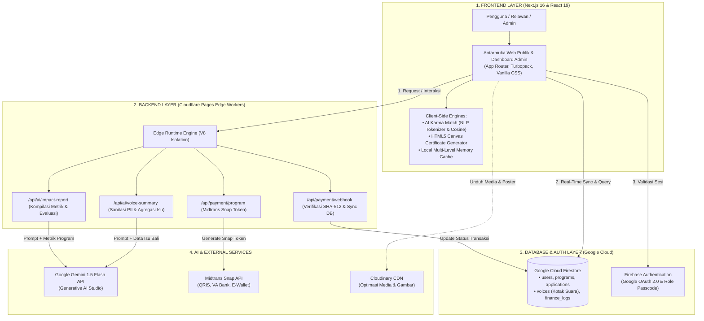
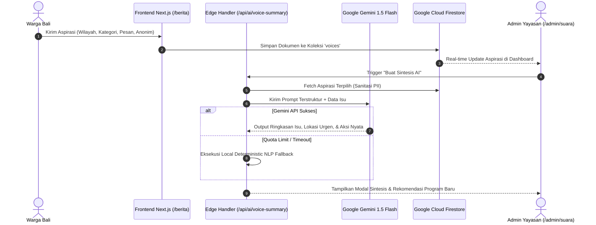

# UNTUK ESOK — Platform Manajemen & Pemberdayaan Relawan Digital Berbasis AI

> **Kategori:** SMA/SMK/Sederajat  
> **Kompetisi:** AI Web Innovation Challenge — Bali DigiFest 2026  
> **Tema:** *Build with AI, Solve for Bali (Bali Smart Society & Education)*  
> **Tagline:** *Build with AI. Solve Real Problems.*  

---

## 1. Description
**Untuk Esok** adalah platform digital terintegrasi yang memberdayakan ekosistem kerelawanan dan aksi sosial di Bali. Platform ini mengintegrasikan kecerdasan buatan (*Artificial Intelligence*) untuk menyelesaikan inefisiensi operasional komunitas sosial, mencakup:
1. **Pencocokan Cerdas Relawan (*Karma Match Engine*)**: Memasangkan minat relawan dengan program sosial yang paling membutuhkan bantuan melalui analisis semantik NLP.
2. **Sintesis Akuntabilitas Berbasis AI (*AI Social Impact Report*)**: Mengubah kumpulan metrik kegiatan dan ulasan relawan menjadi laporan dampak sosial terstruktur untuk mitra/sponsor menggunakan Google Gemini 1.5 Flash.
3. **Sintesis Aspirasi & Kotak Suara Warga (*AI Citizen Voice Synthesizer*)**: Menampung keluhan dan aspirasi masyarakat di 9 kabupaten/kota di Bali melalui Kotak Suara Warga di `/berita` dan `/admin/suara`, lalu merumuskan prioritas isu dan rekomendasi aksi nyata yayasan menggunakan Gemini AI.
4. **Penerbitan & Verifikasi Sertifikat 1-Klik**: Otomatisasi sertifikat digital berakurasi piksel tinggi menggunakan HTML5 Canvas dengan QR Code verifikasi publik on-the-fly (`/verify/:id`).
5. **Portal Relawan & Fitur Klaim Sertifikat**: Berbagi capaian dampak sosial dengan fitur klaim sertifikat digital dan sistem ulasan reflektif 4-slide.

---

## 2. Problem
Komunitas sosial dan yayasan nirlaba di Bali menghadapi tiga hambatan struktural utama:
1. **Inefisiensi Operasional & Fragmentasi Alat**: Rekrutmen, verifikasi komitmen fee, presensi lapangan, dan penerbitan sertifikat masih dilakukan manual melalui kombinasi Google Forms, Spreadsheet, WhatsApp, dan Canva yang memakan waktu berhari-hari.
2. **Ketiadaan Akuntabilitas Dampak Sosial Terukur**: Evaluasi kualitatif dari relawan sering kali terbengkalai dan tidak terdokumentasi rapi, sehingga komunitas kesulitan menyajikan laporan pertanggungjawaban (*Executive Summary*) yang kredibel kepada mitra yayasan dan sponsor.
3. **Ketidaksesuaian Relawan (*Volunteer Mismatch*)**: Relawan kesulitan menemukan kegiatan sosial yang selaras dengan keterampilan, ketersediaan waktu, dan minat mereka, sementara kegiatan kritis di daerah pelosok Bali sering kekurangan kuota peserta.

---

## 3. Target User
1. **Pengelola Komunitas & Yayasan Sosial di Bali (Admin / Organizers)**: Membutuhkan platform terpadu untuk membuka pendaftaran relawan, memantau keuangan kegiatan, mencatat presensi, dan menerbitkan laporan serta sertifikat resmi secara instan.
2. **Generasi Muda & Masyarakat Umum (Volunteers)**: Pelajar, mahasiswa, dan masyarakat di Bali yang ingin berkontribusi sosial, menemukan kegiatan yang relevan, memantau jam kontribusi, dan mengklaim sertifikat terverifikasi.
3. **Mitra Kolaborasi, Sponsor, & Publik**: Memeriksa keabsahan sertifikat relawan melalui QR Code verifikasi serta meninjau laporan transparansi dampak sosial program.

---

## 4. Key Features

### A. Fitur Inti (Core Features)
- **AI Karma Match Engine**: Sistem rekomendasi berbasis keselarasan semantik (NLP), preferensi komitmen, dan urgensi kuota kegiatan sosial (Skor 0–100%).
- **AI Social Impact & Partner Report**: Sintesis multi-metrik (kehadiran, total jam kontribusi, ulasan relawan) menjadi laporan eksekutif dan narasi publik menggunakan model bahasa Gemini AI.
- **Auto Certificate Generator (Pixel-Perfect Canvas Engine)**: Menghasilkan sertifikat resmi on-the-fly dengan nomor registrasi unik, penandatangan dinamis per kegiatan, dan QR Code verifikasi resmi tanpa membebani penyimpanan server (*Zero Storage Cost*).
- **Sistem Verifikasi Publik (`/verify/:id`)**: Pemeriksaan keaslian sertifikat digital secara instan dengan proteksi hash identitas relawan dan opsi unduh PNG resolusi tinggi.
- **Sistem Pembayaran & Tiket Terintegrasi**: Integrasi payment gateway Midtrans (QRIS, Virtual Account BCA/BNI/BRI, GoPay, ShopeePay) dengan verifikasi otomatis server-side dan invoice digital interaktif.

### B. Fitur Pendukung (Supporting Features)
- **Portal Relawan Interaktif (`/akun`)**: Story modal 4-slide untuk fitur klaim sertifikat digital, rekap capaian jam kontribusi, dan form refleksi kegiatan.
- **Dashboard Manajemen Terpadu (`/admin`)**: Rute kanonikal Bahasa Indonesia untuk pengelolaan data relawan, validasi pendaftaran, pembukuan kas/keuangan (50/50 Donut Chart), analitik demografi, dan manajemen berita.
- **Multi-Level Cache System**: Performa render cepat dengan local state caching dan prefetching rute Next.js.

---

## 5. Tech Stack
- **Frontend**: Next.js 16 (App Router + Turbopack), React 19, Framer Motion, Vanilla CSS Design System.
- **Design System & Guidelines**: Anti-AI-Slop Architecture ([DESIGN.md](DESIGN.md)) — Filosofi desain bebas ornamen artifisial, tanpa emoji/dekorasi hampa, dan mengutamakan kejelasan fungsi.
- **Backend / API**: Next.js Serverless Route Handlers (Edge Runtime & Node.js).
- **Database & Auth**: Google Cloud Firestore (NoSQL Realtime Database), Firebase Authentication (Google OAuth & Multi-Auth).
- **Artificial Intelligence**:
  - Google Gemini 1.5 Flash API (Server-Side Sanitized Integration)
  - Hybrid NLP Tokenizer & Cosine Semantic Similarity Matcher (Local Engine)
- **Payment Gateway**: Midtrans Snap API (Sandbox Mode).
- **Media & Asset Management**: Cloudinary API (Server-side signed upload).
- **Linter & Quality Gate**: Oxlint (0 errors, 0 warnings).
- **Deployment / Hosting**: Cloudflare Pages.

---

## 6. AI Implementation

### A. AI Social Impact Synthesizer (`/api/ai/impact-report`)
- **Model / API**: Google Gemini 1.5 Flash API (`gemini-1.5-flash`).
- **Fungsi AI**: Mensintesis kumpulan ulasan kualitatif relawan (*kesan, pesan, pembelajaran*) bersama metrik kuantitatif (*kehadiran, donasi, jam kerja*) menjadi 3 output terstruktur:
  1. *Executive Summary*: Ringkasan dampak program untuk pimpinan yayasan mitra.
  2. *Operational Insights*: Evaluasi kritis kendala lapangan dan rekomendasi batch selanjutnya.
  3. *Social Media Narrative*: Rangkuman cerita inspiratif yang siap dipublikasikan ke media sosial (Instagram).
- **Input**: Data agregat relawan yang telah melalui **Sanitasi PII** (email, nomor WhatsApp, dan data identitas pribadi dibersihkan sebelum dikirim ke API).
- **Output**: JSON terstruktur dengan format Markdown yang dapat disalin ke clipboard atau diunduh oleh admin.
- **Reliability & Fallback**: Dilengkapi *Deterministic Semantic Fallback Synthesizer* lokal jika API pihak ketiga mengalami downtime atau pembatasan kuota (*zero-downtime guarantee*).

### B. Karma Match Engine (`src/lib/karmaMatchEngine.js`)
- **Model / Algoritma**: Hybrid NLP Semantic Cosine Similarity + Multi-Factor Scoring (Natural Language Processing lokal).
- **Fungsi AI**: Mencocokkan profil dan kueri pencarian calon relawan terhadap program sosial yang paling relevan.
- **Formula Scoring**:
  $$\text{Score} = (\text{Sim}_{\text{NLP}} \times 0.40) + (\text{Sim}_{\text{Category}} \times 0.25) + (\text{PriceFit} \times 0.20) + (\text{UrgencyFit} \times 0.15)$$
- **Input**: Kueri pencarian pengguna, riwayat partisipasi kategori, dan willingness-to-commit.
- **Output**: Skor kecocokan 0–100%, lencana tingkat kecocokan (*Sangat Cocok*, *Cocok*, dll.), dan alasan rekomendasi kontekstual.

---

## 7. Architecture

Arsitektur sistem **UNTUK ESOK** dirancang berbasis pola **Edge-Native Serverless** untuk menjamin latensi minimal, keandalan tinggi, dan efisiensi biaya operasional (*Zero Storage Cost*). Arsitektur ini memisahkan logika komputasi klien, perutean edge, basis data terdistribusi, dan layanan model AI secara modular.

### A. Diagram Arsitektur Sistem (Mermaid Flowchart)


### B. Penjelasan 4 Alur Arsitektur Utama

1. **Alur Frontend (Presentation & Client Logic Layer)**:
   - **Framework & Rendering**: Dibangun dengan **Next.js 16 (App Router + Turbopack)** dan **React 19**, memanfaatkan kombinasi Server Components untuk optimasi SEO pada halaman publik (`/`, `/berita`, `/kegiatan`) serta Client Components untuk interaktivitas dinamis pada Portal Relawan (`/akun`) dan Dashboard Operasional (`/admin/*`).
   - **Edge-Side Compute Offloading**:
     - *Karma Match Engine*: Menjalankan tokenisasi teks, penghapusan *stop words*, dan kalkulasi *Cosine Semantic Similarity* secara lokal di browser pengguna. Hal ini menghasilkan rekomendasi program dengan latensi 0 ms tanpa membebani server backend.
     - *HTML5 Canvas Certificate Engine*: Me-render e-sertifikat beresolusi tinggi (2000×1414 piksel) langsung di GPU peramban dengan font resmi Cinzel dan QR Code verifikasi dinamis, mencapai efisiensi biaya penyimpanan (*Zero Storage Cost*).
   - **State & Optimistic Cache**: Menyediakan *Local Multi-Level Cache* untuk meredam pemanggilan ulang data berlebih dan memastikan transisi antar-halaman berjalan instan.

2. **Alur Backend (Cloudflare Pages Edge Runtime Layer)**:
   - **Runtime Serverless**: Dijalankan pada **Cloudflare Pages Edge Workers** berbasis V8 isolates dengan waktu *cold-start* mendekati 0 milidetik dan jangkauan *global edge network*.
   - **Tanggung Jawab & Keamanan**:
     - *Sanitasi PII*: Membersihkan identitas sensitif pengguna sebelum data diagregasi dan dikirim ke layanan AI eksternal.
     - *Validasi Kriptografis*: Pada endpoint webhook pembayaran (`/api/payment/webhook`), backend menghitung ulang hash SHA-512 dari `order_id`, `status_code`, `gross_amount`, dan Server Key untuk mencegah serangan pemalsuan status transaksi (*tampering*).
     - *Orkestrasi Prompt AI*: Mengontrol format instruksi (*system prompt*), menetapkan batasan token, dan memvalidasi output JSON dari model bahasa sebelum dikembalikan ke klien.

3. **Alur Database & Otentikasi (Google Cloud Firestore & Firebase Auth)**:
   - **Basis Data NoSQL Real-Time**: Menggunakan **Google Cloud Firestore** dengan skema dokumen modular:
     - `voices`: Menampung aspirasi masyarakat 9 kabupaten/kota di Bali dengan flag moderasi status (`diterima`, `diproses`, `diarsipkan`) dan penanda anonimitas.
     - `programs`: Katalog kegiatan kerelawanan, kuota, target donasi, dan lokasi kegiatan.
     - `applications`: Rekam jejak pendaftaran, presensi lapangan, dan kode penerbitan sertifikat.
     - `finance_logs`: Buku kas masuk/keluar terstruktur untuk transparansi akuntabilitas publik.
   - **Sinkronisasi Data**: Menggunakan *real-time snapshot listener* sehingga pembaruan status pendaftaran relawan atau penambahan suara warga baru langsung terrefleksi di antarmuka admin tanpa *polling*.
   - **Otentikasi & Hak Akses**: Dikelola oleh **Firebase Authentication** dengan Google OAuth 2.0 untuk akun relawan publik, serta proteksi sesi terisolasi dengan verifikasi passcode untuk rute administratif (`/admin/*`).

4. **Alur AI & Integrasi Eksternal API**:
   - **Google Gemini 1.5 Flash API**:
     - Menerima payload bersih dari backend edge, mengeksekusi sintesis kualitatif, dan mengembalikan ringkasan eksekutif, identifikasi isu prioritas, serta pitch proposal mitra.
     - **Fallback NLP Deterministic**: Jika koneksi eksternal atau batas kuota API tercapai, sistem secara otomatis mengaktifkan modul fallback lokal berbasis heuristik sehingga alur aplikasi tidak pernah terputus (*zero downtime*).
   - **Midtrans Snap API**: Menyediakan pembayaran multi-kanal (QRIS GoPay/ShopeePay, Virtual Account Bank) dengan alur pembuatan token snap di sisi server dan modal pembayaran terintegrasi di sisi klien.
   - **Cloudinary API**: Menyimpan dan mengoptimasi aset visual banner kegiatan serta artikel berita dengan transformasi otomatis format web modern (WebP/AVIF).

### C. Alur Komunikasi End-to-End: AI Voice Synthesis (Mermaid Sequence)


---

## 8. Installation / Local Run

### Prasyarat:
- Node.js versi 18.18+ atau Node.js 20+
- Package manager `npm` atau `pnpm`

### Langkah Instalasi:

1. **Clone Repository**:
   ```bash
   git clone https://github.com/abibhaskara/untukesok.git
   cd untukesok
   ```

2. **Instalasi Dependensi**:
   ```bash
   npm install
   ```

3. **Konfigurasi Environment Variables**:
   Salin file template `.env.example` menjadi `.env.local`:
   ```bash
   cp .env.example .env.local
   ```
   Isi konfigurasi Firebase, Midtrans, Cloudinary, dan Gemini API sesuai akun pengujian Anda.

4. **Jalankan Mode Pengembangan (Local Dev Server)**:
   ```bash
   npm run dev
   ```
   Buka peramban di `http://localhost:3000`.

5. **Verifikasi Kualitas & Produksi (Build & Lint)**:
   ```bash
   npm run lint   # Memeriksa kepatuhan kode dengan Oxlint (0 warnings)
   npm run build  # Mengompilasi aplikasi untuk kesiapan produksi Next.js
   ```

---

## 9. Environment Variables
Gunakan template [`.env.example`](.env.example) sebagai acuan. **Dilarang keras melakukan commit file kredensial asli (`.env.local` / `.env.production`) ke dalam repositori.**

| Variabel | Deskripsi | Sifat Kunci |
| :--- | :--- | :--- |
| `NEXT_PUBLIC_FIREBASE_API_KEY` | Firebase Web API Key | Client-Side (Public) |
| `NEXT_PUBLIC_FIREBASE_PROJECT_ID` | ID Proyek Google Firebase | Client-Side (Public) |
| `NEXT_PUBLIC_FIREBASE_STORAGE_BUCKET` | Bucket Google Cloud Storage | Client-Side (Public) |
| `MIDTRANS_SERVER_KEY` | Server Key Midtrans untuk transaksi | **Server-Side Only (Private)** |
| `NEXT_PUBLIC_MIDTRANS_CLIENT_KEY` | Client Key Midtrans Snap modal | Client-Side (Public) |
| `CLOUDINARY_API_KEY` & `SECRET` | Akses upload gambar media server-side | **Server-Side Only (Private)** |
| `NEXT_PUBLIC_ADMIN_PASSCODE` | PIN sesi administrasi dashboard | Client-Side Passcode |
| `GEMINI_API_KEY` | Google AI Studio Gemini API Key | **Server-Side Only (Private)** |

---

## 10. Deployment
- **Live Deployed Website**: [https://untukesok.id](https://untukesok.id) *(atau URL aktif deployment panitia)*
- **Status Hosting**: Cloudflare Pages (Edge & Hybrid Serverless)
- **Akun Akses Demo Juri**:
  - *Email Demo*: Disediakan melalui form submission resmi panitia.
  - *Password Demo*: Disediakan melalui form submission resmi panitia.
  - *Akses Admin Demo*: Terdapat passcode demo yang dikirimkan pada form resmi panitia demi kepatuhan keamanan *Security Rules* Juknis.

---

## 11. Team Members
**Tim Untuk Esok** — Kategori: SMA/SMK/Sederajat

| Nama Anggota | Peran & Tanggung Jawab Utama | Kontak |
| :--- | :--- | :--- |
| **Abi Bhaskara** | **Ketua Tim / Lead Full-Stack & AI Engineer**<br>Arsitektur sistem, integrasi Gemini AI, Canvas Certificate Engine, dan backend API. | abibhaskaramulya@icloud.com |
| **Anggota Tim 1** | **UI/UX Designer & Frontend Developer**<br>Rancang antarmuka portal relawan, landing page responsif, dan fitur klaim sertifikat interaktif. | *(sesuai form registrasi)* |
| **Anggota Tim 2** | **Product Researcher & QA Tester**<br>Riset kebutuhan komunitas sosial Bali, validasi user journey, dan pengujian keandalan aplikasi. | *(sesuai form registrasi)* |

---

## 12. Third-party Resources / Credits
- **Google Gemini API**: Model bahasa cerdas untuk peringkasan dampak sosial kualitatif.
- **Firebase Web SDK**: Otentikasi pengguna dan database dokumen cloud real-time.
- **Midtrans Snap**: Antarmuka pembayaran terintegrasi QRIS dan Virtual Account.
- **Cloudinary**: Pengelolaan dan optimasi aset visual artikel berita.
- **Framer Motion**: Animasi transisi fluid pada antarmuka web.
- **Cinzel & Plus Jakarta Sans Font**: Tipografi resmi berlisensi open-source (Google Fonts) untuk template sertifikat dan antarmuka.
- **React Icons**: Koleksi ikon antarmuka berbasis SVG.

---

## 13. Known Limitations
1. **Pembatasan Kuota API Eksternal**: Pemanggilan Google Gemini API bergantung pada kuota rate-limit AI Studio (diatasi dengan mekanisme fallback NLP lokal teruji).
2. **Lingkungan Pembayaran**: Pembayaran saat ini berjalan pada lingkungan *Sandbox Midtrans* untuk demonstrasi kompetisi tanpa memotong dana riil pengguna.
3. **Canvas Rendering Support**: Mesin rendering sertifikat lokal memerlukan peramban web modern yang mendukung standar HTML5 Canvas.

---

## 14. AI & Technology Disclosure
*(Sesuai Ketentuan Juknis Halaman 6, 7, 10, dan 12)*

### A. Status Pengembangan Karya (Pre-existing vs. Competition Development)
- **Existing before competition**:
  - Inisiatif komunitas sosial Untuk Esok dan struktur dasar katalog program relawan.
- **Development for competition**:
  - Rancang bangun **AI Karma Match Engine** untuk pencocokan semantik relawan.
  - Integrasi **AI Social Impact & Partner Report** dengan sanitasi PII dan model Gemini 1.5 Flash.
  - Pembangunan mesin sertifikat digital otomatis dengan QR Code verifikasi publik on-the-fly (`/verify/:id`).
  - Restrukturisasi arsitektur rute kanonikal Bahasa Indonesia (penghapusan total sistem re-route proxy).
  - Hardening keamanan server-side (validasi harga, hash webhook, eliminasi kunci rahasia dari git tree).

### B. Penggunaan AI-Assisted Coding Tools
- **Tools**: Google Antigravity / Gemini Code Assist.
- **Tujuan Penggunaan**: Pembuatan boilerplate refactoring, optimasi performa linter, dan penulisan dokumentasi teknis. Seluruh logika bisnis, prompt engineering, arsitektur, dan source code telah diverifikasi dan menjadi tanggung jawab penuh peserta.

---

## 15. Version Locking
*(Sesuai Ketentuan Juknis Halaman 11)*

- **Tahap 1 Submission Tag**: `v1.0-submission`
- **Commit Hash Terverifikasi**: `fbfa3e7` (Root Commit — *V.1.0 FINAL*)
